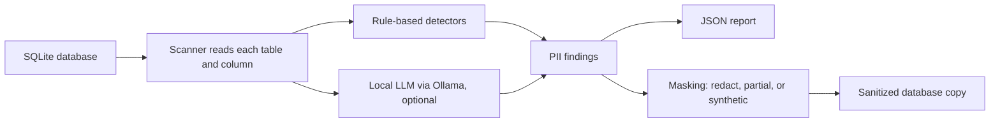

# PII Guard

A Python tool that finds sensitive personal data (PII) in SQLite databases and creates safe, sanitized copies for development and testing. It combines fast rule-based detection with an optional **local LLM** (via Ollama) that catches PII rules miss, like names and addresses inside free-text fields. Because the model runs locally, sensitive data never leaves the machine.

All sample data in this project is fake, generated with Faker.

## Features

- **Scan** every table and column and report which kinds of PII each contains
- **Rule-based detection** for emails, phone numbers, SSNs, credit cards (with Luhn checksum validation), IP addresses, and dates of birth
- **Column-name hints** that flag fields like `full_name` or `address` even when values are hard to pattern-match
- **Local LLM detection** (optional) for unstructured text such as support tickets
- **Sanitize** a copy of the database using one of three strategies:
  - `redact`: replace with a label like `[EMAIL]`
  - `partial`: keep only the last 4 characters (`*******6789`)
  - `synthetic`: replace with realistic fake values so test data still looks real
- Original database is never modified

## How It Works



## Quick Start

```bash
pip install -r requirements.txt

# 1. Create a database of fake customer data
python scripts/make_sample_db.py sample.db

# 2. Scan it and save a report
python -m pii_guard.cli scan sample.db --out report.json

# 3. Create a sanitized copy
python -m pii_guard.cli sanitize sample.db clean.db --strategy synthetic
```

## Using the Local LLM

Install [Ollama](https://ollama.com), then:

```bash
ollama pull llama3.2
python -m pii_guard.cli scan sample.db --llm
python -m pii_guard.cli sanitize sample.db clean.db --llm
```

If Ollama is not running, the tool automatically falls back to rules only.

**Why both rules and an LLM?** Rules are fast and reliable for structured values like emails and SSNs. They can't recognize a name inside a sentence like *"Hi, this is Kathleen Schmidt, please call me back."* The LLM handles that kind of free text.

## Example Report

```json
"email": {
  "pii_types": ["EMAIL"],
  "matches_in_sample": 50,
  "rows_sampled": 50
}
```

## Project Structure

```
pii_guard/
  detectors.py   Regex patterns, Luhn check, column-name hints
  llm.py         Local Ollama client and response parsing
  masking.py     Redact, partial, and synthetic masking strategies
  scanner.py     Database scanning and sanitizing
  cli.py         Command-line interface
scripts/
  make_sample_db.py   Generates a fake customer database
tests/
  test_pii_guard.py   Unit and end-to-end tests
```

## Running Tests

```bash
python -m pytest
```

## Future Improvements

- Support for PostgreSQL and CSV files
- Confidence scores for each finding
- Compare LLM accuracy against rule-based detection on a labeled test set
